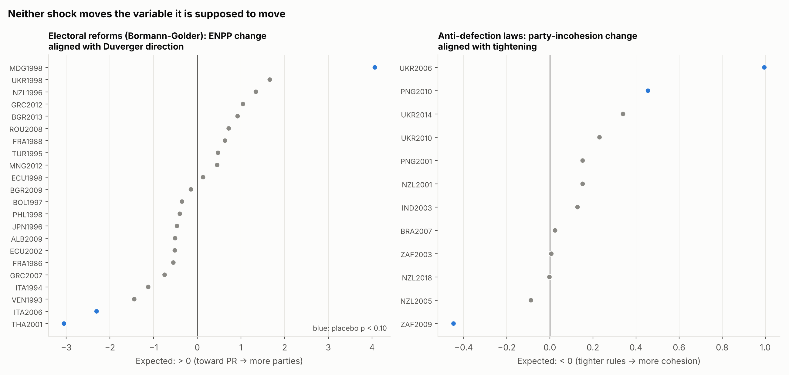
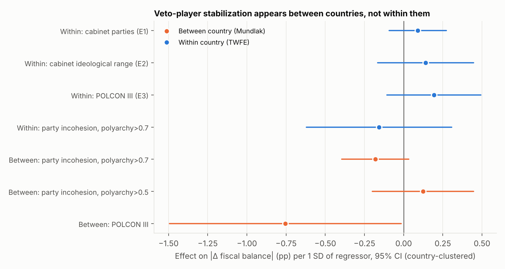
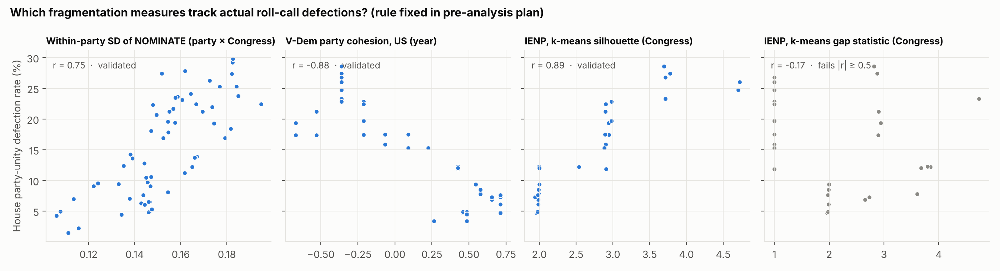
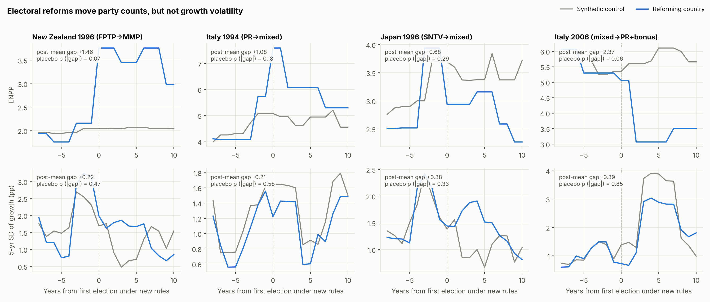
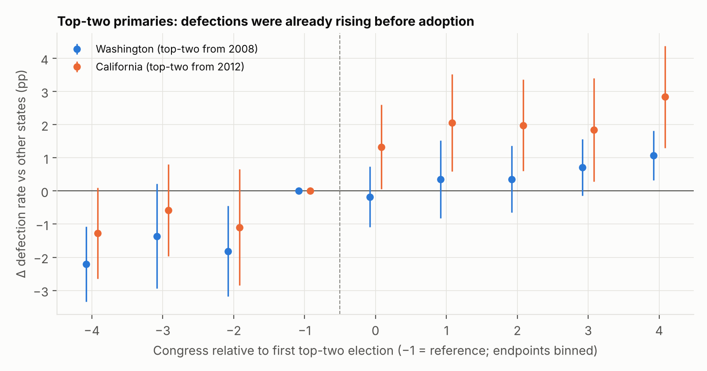
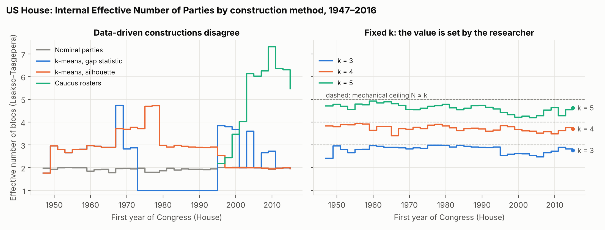
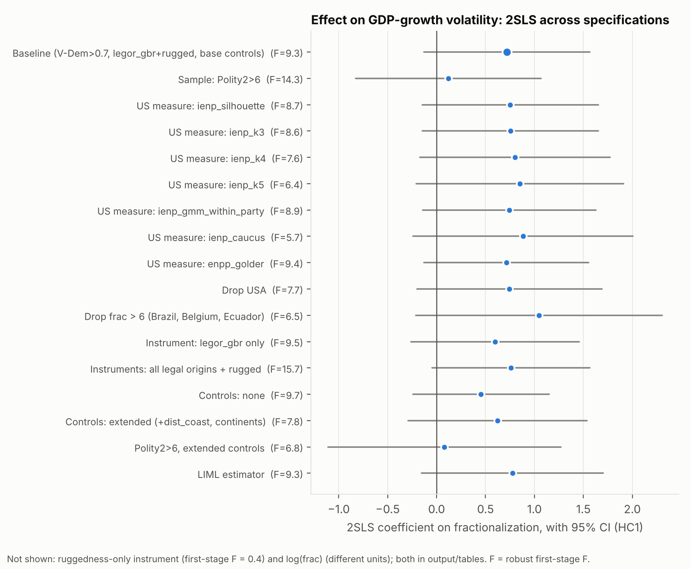

# Results (v3): Political Fractionalization and Macroeconomic Volatility

**Version 3** adds **Part III**, which follows up the open questions of v2 §II.7:
- within-country shocks to party discipline (anti-defection laws);
- direct tests of veto-player theory;
- a systematic catalogue of 22 electoral reforms in place of four.

Part III was pre-registered in [`docs/pre_analysis_plan_part3.md`](docs/pre_analysis_plan_part3.md)
(commit `57a6546`) before its outcome regressions were run. Parts II and I are unchanged below.

## Bottom line

**No design that produces within-country variation shows that party fragmentation or party
discipline moves macroeconomic volatility.** The one robust pattern, looser parties with steadier
budgets, is a **between-country** association among established democracies. It matches the
veto-player literature's cross-sectional findings, but it is not identified, and it does not
appear when the same countries' cohesion changes over time.

| Question | Answer |
|---|---|
| Does the US-only "IENP" measure fragmentation? | **Only some versions.** Validated against roll-call defections, the gap-statistic IENP (Part I's primary) fails (r = −0.17), and caucus rosters get the sign wrong (r = −0.85). Within-party ideological spread (r = 0.75), silhouette IENP (0.89) and V-Dem party cohesion (−0.88) pass. |
| Do national electoral reforms that shift party counts shift volatility? | **No.** In the four-reform design (Part II): +0.09 pp per party on growth instability (randomization p = 0.92), −0.03 pp on fiscal instability (p = 0.91). Pooling 22 reforms (Part III) does not help: the Duverger direction does not predict the change in ENPP. Only 10 of 22 reforms move the expected way (first-stage p = 0.50). |
| Do anti-defection laws tighten party discipline, and does that move budgets? | **Neither.** Across 14 dated adoptions and repeals, tightening is followed by *lower* measured cohesion (+0.17 incohesion, wrong sign, p = 0.11). Only 3 of 12 events move the expected way. Reduced form on fiscal instability: p = 0.70. |
| Do veto players stabilize budgets within countries? | **No.** More cabinet parties, a wider coalition ideological range, and higher POLCON all have *positive* within-country point estimates (p = 0.21–0.37). The 95% intervals rule out stabilizing effects larger than 0.11–0.17 pp per SD (6–10% of the mean). |
| Between countries? | **Yes, as the literature reports.** Countries with more formal veto points have smaller fiscal swings (−0.75 pp per SD of POLCON, p = 0.045), replicating Henisz (2004) and Fatás & Mihov (2003). |
| Does polarization raise volatility only under single-party government (reconciling Azzimonti & Talbert)? | **No.** The interaction is zero (p = 0.995). A shift in the prime minister's party ideology does go with larger fiscal changes (+0.15 pp per left-right point, p = 0.013, secondary), under coalitions as much as single-party governments. |
| Do top-two primaries fragment US House parties? | **No credible evidence.** Randomization p = 0.22; within the same members +0.4 pp (p = 0.77). |
| Do more open primaries widen state-party ideological spread? | **Weakly at most.** Randomization p = 0.18 for the registered index; the binary version gives p = 0.02 but rests on only 9 switching state-parties. |
| Are US parties unusually loose, measured the same way for every country? | **Yes.** 89th percentile of incohesion among established democracies. |
| Is looseness associated with steadier budgets? | **Between countries, among established democracies only.** Cross-section −0.43 (Holm p = 0.04), robust to a POLCON control (−0.41, p = 0.008). Panel between-country estimate −0.17 (p = 0.10) for polyarchy > 0.7; it reverses (+0.11) when electoral democracies are included. Within countries: −0.15 (p = 0.51). |

---

# Part III: Veto players and identified shocks to party discipline (pre-registered)

Scripts:
- `scripts/eventlib.py`: stacked designs with exact randomization inference;
- `scripts/11_antidefection.py`: Design D;
- `scripts/12_veto_players.py`: Design E;
- `scripts/13_reform_catalogue.py`: Design F;
- `scripts/14_part3_summary.py`: Holm adjustment and figures.

## III.0 Theory: veto players instead of gridlock

The original design assumed that fragmentation causes gridlock, and gridlock causes volatility.
Veto-player theory (Tsebelis 2002) predicts the opposite. The more actors whose agreement a policy
change needs, the larger the set of policies that cannot be overturned, so changes are smaller.

Part III tests the three channels this implies:
- **Formal veto points:** Henisz's POLCON index; the number of coalition partners and their
  ideological range.
- **Informal veto players:** loose party discipline, which makes individual legislators pivotal.
- **Partisan alternation:** polarization should matter only when it produces swings between
  single-party governments (Azzimonti & Talbert 2014).

## III.1 Design D: anti-defection laws as shocks to party discipline

**Events.** 14 adoptions and repeals in 7 countries, dated from the legal record
(`data/reference/anti_defection_events.csv`, sources listed).
- India 1985, 2003
- Israel 1991
- Brazil 2007 (supreme-court and electoral-court fidelity rulings)
- New Zealand 2001, 2005 (expiry), 2018
- South Africa 2003 (floor-crossing allowed), 2009 (abolished)
- Papua New Guinea 2001, 2010 (struck down)
- Ukraine 2006, 2010, 2014

Controls are democracies (V-Dem polyarchy > 0.5) with no event in the ±6-year window. The design
is a stacked, signed DiD/2SLS with stack × country and stack × year fixed effects. Inference is
exact RI: 2,000 reassignments of each event to a random eligible control.

| Outcome | First stage (incohesion) | RI p | Reduced form | RI p | 2SLS | Events |
|---|---|---|---|---|---|---|
| \|Δ fiscal\| **(D1)** | **+0.165** (wrong sign) | 0.11 | −0.19 | **0.70** | −1.15 | 12 |
| \|Δ growth\| | +0.107 | 0.20 | −0.74 | 0.23 | −6.9 | 13 |
| 5-yr SD fiscal | +0.185 | 0.09 | −0.35 | 0.42 | −1.9 | 11 |

**The pre-registered relevance rule fails:** the first-stage sign is wrong, so D is uninformative.

Only 3 of 12 events move cohesion in the expected direction, and the largest move goes the wrong
way: incohesion rose by 1.0 after Ukraine imposed the imperative mandate in 2006, amid the 2006–07
crisis.

This fits the adoption literature: Nikolenyi & Shenhav (2015) show these laws are passed *during*
defection crises. It also fits a measurement point. The laws police *exit* (switching parties).
V-Dem cohesion measures *voice* (voting against the party on important bills). Banning exit need
not increase voting unity.

## III.2 Design E: the veto-player panel

**Data.** ParlGov cabinets for 37 countries (the cabinet in office on 1 January of each year), plus
POLCON III for 110 democracies. Two-way fixed effects, SEs clustered by country.

| Test | Regressor → outcome | Coef. | SE | p | 95% CI per 1 SD | Prediction |
|---|---|---|---|---|---|---|
| E1 | Cabinet parties → \|Δ fiscal\| | +0.064 | 0.067 | 0.34 | [−0.09, +0.27] pp | − |
| E2 | Cabinet ideological range → \|Δ fiscal\| | +0.077 | 0.087 | 0.37 | [−0.17, +0.45] pp | − |
| E3 | POLCON III → \|Δ fiscal\| | +0.891 | 0.707 | 0.21 | [−0.11, +0.49] pp | − |
| E4 | Polarization × single-party → \|Δ growth\| | +0.016 | 2.69 | 0.995 | — | + |
| E5 (sec.) | PM-party left-right swing × single-party → \|Δ fiscal\| | −0.12 | 0.10 | 0.24 | — | + |

- Mean |Δ fiscal| is 1.7–1.95 pp.
- **Every within-country veto-player estimate has the wrong sign**, and the intervals exclude
  stabilizing effects larger than 0.11–0.17 pp per SD.
- **Partisan alternation does matter, but not as predicted.** In E5, the main effect of a swing in
  the PM party's ideology is +0.15 pp per left-right point (p = 0.013) under coalitions. The
  single-party interaction does not amplify it.

**Between versus within** (Mundlak decomposition; `output/tables/incohesion_between_within.csv`):

| Model | Term | Coef. | p |
|---|---|---|---|
| \|Δ fiscal\| panel, polyarchy > 0.7 (70 countries) | incohesion, between | −0.167 | 0.10 |
| | incohesion, within | −0.145 | 0.51 |
| \|Δ fiscal\| panel, polyarchy > 0.5 (113 countries) | incohesion, between | +0.114 | 0.45 |
| | incohesion, within | +0.023 | 0.90 |
| Panel + country-mean POLCON | POLCON, between | **−3.48** | **0.045** |
| C1b cross-section + mean POLCON | incohesion | **−0.41** | **0.008** |

**Reading.** Veto-player stabilization is real *between* countries, both through formal veto
points (POLCON) and, among established democracies, through loose parties. But neither formal nor
informal veto players stabilize budgets when they change *within* a country.

The most plausible explanation is that both proxy for stable traits of consensual polities:
coalition traditions, independent fiscal institutions, corporatist bargaining. Those traits do not
move when a cabinet gains a partner or a law changes. This also explains why Henisz's and
Fatás-Mihov's cross-sectional results replicate here while the within-country tests fail.

## III.3 Design F: a systematic electoral-reform catalogue

**Events.** All changes of electoral-system family in Bormann & Golder's DES codes, 1966–2015, in
the year after a democratic election coded the previous year: 30 events.
- **Broad sample** (polyarchy > 0.5 the year before): 22 events, including France 1986/88,
  Bolivia 1997, Venezuela 1993, Thailand 2001, Philippines 1998, Greece 2007/12, Bulgaria
  2009/13, Ecuador 1998/2002, Romania 2008, Ukraine 1998, Mongolia 2012, Madagascar 1998,
  Albania 2009, Turkey 1995.
- **Clean sample** (polyarchy > 0.7): 11 events.

The catalogue is in `data/processed/reform_catalogue.csv`. The instrument is the Duverger direction
fixed in advance (toward PR +1, toward majoritarian −1) × post.

| Sample | Outcome | First stage (ENPP) | RI p | Reduced form | RI p | Events |
|---|---|---|---|---|---|---|
| Broad | \|Δ growth\| **(F1)** | −0.13 (wrong sign) | 0.50 | −0.45 | **0.31** | 22 |
| Broad | \|Δ fiscal\| **(F2)** | −0.09 (wrong sign) | 0.69 | −0.23 | **0.49** | 21 |
| Clean | \|Δ growth\| | −0.43 (wrong sign) | 0.12 | +0.03 | 0.96 | 11 |
| Clean | \|Δ fiscal\| | −0.35 (wrong sign) | 0.20 | −0.61 | 0.14 | 11 |

**More events did not buy power.** The a priori direction of a reform does not predict where party
counts go within ten years. Only 10 of 22 reforms move ENPP the expected way. Of the three
significant movers, one goes as expected and two go against it:
- Madagascar 1998: −4.1 parties after a move toward majoritarian rules (as expected);
- Thailand 2001: −3.1 after a move "toward PR" (against);
- Italy 2006: −2.3 under proportional representation with a majority bonus (against).

This is Colomer's (2005) "Duverger's laws upside down" pattern. Fragmented party systems adopt
proportional rules, and party systems then consolidate. Mixed and bonus systems also blur DES's
three-family coding. The 2SLS estimates (+2.6 to +3.4) are therefore meaningless. All reduced
forms are null.

## III.4 Primary hypothesis family (Holm, 7 tests)

| Test | Hypothesis | Estimate | p | Inference | Holm |
|---|---|---|---|---|---|
| D1 | Anti-defection 2SLS: incohesion → \|Δ fiscal\| | −1.15 | 0.70 | RI | 1.00 |
| E1 | Cabinet parties → \|Δ fiscal\| | +0.064 | 0.34 | cluster | 1.00 |
| E2 | Cabinet ideological range → \|Δ fiscal\| | +0.077 | 0.37 | cluster | 1.00 |
| E3 | POLCON III → \|Δ fiscal\| | +0.891 | 0.21 | cluster | 1.00 |
| E4 | Polarization × single-party → \|Δ growth\| | +0.016 | 0.995 | cluster | 1.00 |
| F1 | Reform catalogue 2SLS: ENPP → \|Δ growth\| | +3.39 | 0.31 | RI | 1.00 |
| F2 | Reform catalogue 2SLS: ENPP → \|Δ fiscal\| | +2.56 | 0.49 | RI | 1.00 |

**Deviations from the plan.**
- Design D's first-stage rule triggered, so D is reported as uninformative, as registered.
- The between/within decomposition, the POLCON-controlled C1b, and the polyarchy-threshold check
  are **exploratory** additions, not part of the plan.

## III.5 What this adds to the literature

- **Veto players (Henisz 2004; Fatás & Mihov 2003; Tsebelis & Chang 2004).** Their stabilization
  result replicates *between* countries but not *within* them, at an annual horizon. Within-country
  intervals exclude stabilizing effects above 6–10% of mean fiscal change.
  - Tsebelis & Chang studied budget *composition*, not the balance, so E1–E2 test a related but
    different outcome.
- **Party discipline.** The C1b association is new relative to the formal-veto literature and
  survives a POLCON control. It is confined to established democracies and to between-country
  variation. Anti-defection laws cannot serve as an instrument: they don't move voting cohesion,
  in line with Nikolenyi & Shenhav (2015) on why such laws are adopted.
- **Electoral reform (Colomer 2005; Renwick 2010).** Across 22 reforms, the Duverger direction
  predicts ENPP change at chance level, which quantifies Colomer's reverse-causation argument.
  Reform-based instruments for party-system fragmentation are therefore weak *by construction*,
  not just for lack of events.
- **Polarization (Azzimonti & Talbert 2014; Frye 2002).** Their mechanism needs polarization to
  turn into single-party alternation. We find no polarization × single-party interaction among
  ParlGov democracies. We do find that ideological swings in the PM's party enlarge fiscal changes,
  so partisan turnover matters regardless of government type.

---

# Part II: Credible designs (pre-registered)

## II.0 Deviations from the pre-analysis plan

I deviated from the plan in seven places. Each deviation is disclosed here and none changes a
registered test's specification.

1. **Inference.** Cluster-robust SEs are invalid when the treatment varies within one or two
   clusters (Conley & Taber 2011). That was the situation in every design here.
   - For A, B1 and B2 I therefore also report **randomization inference (RI)**: placebo treatments
     assigned to untreated units. RI is the valid test.
   - Both are reported. Holm adjustment is shown for both the as-registered and the RI p-values.
2. **Design A first-stage F.** The clustered F is degenerate (about 10⁷), so I report an
   unadjusted F (54–67) instead.
3. **Design A transition year.** The τ = 0 election year is dropped from each stack entirely,
   not only from the post indicator.
4. **Synthetic control inference.** Besides the registered post/pre RMSPE-ratio p-value, I add an
   exploratory placebo test on |post-period gap|. It only uses donors whose pre-period fit is
   comparable (pre-RMSPE ≤ 2× the treated unit's).
5. **B1:** RI was added for the member-FE variant.
6. **B2:** RI was added.
7. **C1:** N = 56 because one country lacks initial GDP.

## II.1 A fragmentation measure validated against behaviour

I computed **party-unity defection rates** for every House member, Congresses 87–117 (1961–2022),
from Voteview vote-level data (`scripts/06_build_defections.py`). The House-wide mean was about
19% in 1961, peaked near 28% around 1970, and fell to 3.4% in 2021–22.

The registered rule: a measure counts as validated if |r| ≥ 0.5 with the expected sign.

| Candidate measure | Level | N | r with defection rate | Validated? |
|---|---|---|---|---|
| Within-party SD, DW-NOMINATE dim 1 | party × Congress | 62 | **0.75** | ✅ |
| Within-party SD, Nokken-Poole dim 1 | party × Congress | 62 | **0.68** | ✅ |
| V-Dem `v2pscohesv` party cohesion (US) | year | 62 | **−0.88** | ✅ |
| IENP, k-means silhouette | Congress | 29 | **0.89** | ✅ |
| IENP, k = 3 / k = 5 | Congress | 29 | 0.62 / 0.52 | ✅ |
| IENP, k = 4 | Congress | 29 | 0.41 | ❌ |
| IENP, within-party Gaussian mixture | Congress | 29 | 0.19 | ❌ |
| **IENP, gap statistic (Part I primary)** | Congress | 29 | **−0.17** | ❌ |
| IENP, caucus rosters | Congress | 12 | **−0.85** (wrong sign) | ❌ |

**What this means for Part I.**
- Part I's primary US measure does not track actual intra-party dissent.
- The caucus-roster measure tracks the opposite: caucuses proliferated *as* parties became more
  disciplined.
- Within-party ideological spread and V-Dem cohesion pass. They become the measures for Designs B2
  and C.

## II.2 Design A: national electoral reforms

**Setup.** Four reforms (NZ 1996, Italy 1994, Japan 1996, Italy 2006) compared with 18 democracies
whose electoral-system family did not change. Event window τ ∈ [−8, +10], years 1980–2016
(`scripts/07_electoral_reforms.py`).

**Per-event difference-in-differences**, treated country vs clean controls. The placebo p is the
rank among 18 placebo assignments; its minimum attainable value is 0.053.

| Variable | NZL96 | ITA94 | JPN96 | ITA06 |
|---|---|---|---|---|
| ENPP (first stage) | **+1.47** (p .053) | +1.26 (.105) | −0.34 (.37) | **−2.42** (.053) |
| Party incohesion (V-Dem) | +0.21 (.16) | −0.61 (.053) | +0.71 (.053) | +0.07 (.37) |
| Platform polarization (MARPOR) | +0.18 (.053) | +0.04 (.37) | +0.08 (.16) | −0.02 (.42) |
| \|Δ growth\| (pp) | +0.36 (.47) | +0.68 (.32) | +0.42 (.42) | +0.14 (.95) |
| \|Δ fiscal balance\| (pp) | −0.76 (.26) | +0.61 (.42) | +0.94 (.26) | −0.25 (.74) |
| 5-yr SD growth | +0.09 (.84) | +0.51 (.26) | +0.40 (.47) | +0.17 (.84) |

**Stacked 2SLS**, effect per additional effective party:

| Outcome | Coef. | Cluster SE (invalid) | RI p | Unadjusted first-stage F |
|---|---|---|---|---|
| \|Δ growth\| (A1) | +0.085 | 0.082 | **0.92** | 67 |
| \|Δ fiscal\| (A2) | −0.029 | 0.212 | **0.91** | 54 |
| 5-yr SD growth | +0.019 | 0.053 | — | 67 |
| 5-yr SD fiscal | +0.135 | 0.274 | — | 47 |

**Leave-one-event-out.** Coefficients range from −0.00 to +0.32 on |Δ growth|. The only cluster
p below 0.05 comes from dropping Italy 2006, and cluster p-values are invalid here.

**Synthetic control.** Reforms produce clear ENPP gaps: New Zealand +1.46 (|gap| p = 0.07) and
Italy 2006 −2.37 (p = 0.06). None of the growth or fiscal volatility gaps stands out
(p = 0.33–0.90).

**Threat confirmed: reverse causality.** In the eight years before reform, ENPP was already rising
by about 0.23–0.26 parties per year in Italy-94 and Japan-96: Tangentopoli and the LDP split
preceded and *caused* those reforms. New Zealand (+0.05 per year) is the clean case. There, a
1.5-party shock left growth volatility unchanged (+0.22 pp, p = 0.47).

**Conclusion.** Even the cleanest within-country variation available shows no effect of party
counts on macroeconomic instability. Power is limited: four events, and a minimum placebo
p of 0.053. But the point estimates are small and of inconsistent sign across events.

## II.3 Design B1: top-two primaries in the US House

**Setup.** Washington adopted top-two primaries in 2008 (first affected Congress: 111th) and
California in 2012 (113th). Every other state except Louisiana serves as a control.
5,661 member-Congresses, 105th–117th (`scripts/08_us_primaries.py`).

| Outcome | Specification | Coef. | Cluster p | RI p (2,756 placebo state pairs) |
|---|---|---|---|---|
| Defection rate (mean 7.3%) | Pooled, state FE | **+2.9 pp** | <0.001 | **0.22** |
| | Pooled, member FE (same incumbents) | +0.4 pp | 0.40 | **0.77** |
| | WA / CA separately, state FE | +2.2 / +3.0 pp | <0.001 | — |
| \|Nokken-Poole dim 1\| (extremity) | Pooled, state FE | −0.051 | <0.001 | 0.32 |
| | Pooled, member FE | −0.020 | 0.005 | 0.50 |

**Why the apparent effect is not credible.**
1. **Pre-trends.** Both states' defection rates were already rising relative to other states for
   three Congresses before adoption: WA −2.2 → 0 pp, CA −1.3 → 0 pp.
2. **Two treated clusters.** Cluster SEs drastically overstate precision. Assigning the same
   timing to placebo state pairs gives effects this large 22% of the time.
3. **No change within the same members.** The member-FE estimate is near zero, so any
   change comes from turnover rather than from incumbents behaving differently.

This matches the existing literature (Kousser, Phillips & Shor 2018; McGhee & Shor 2017).

## II.4 Design B2: primary openness in state legislatures

**Setup.**
- Primary type: McGhee et al. (2014) coding for 1992–2010.
- Outcome: within-party SD of Shor-McCarty ideal points (validated in II.1).
- Panel: 1,502 state-party-years in lower chambers; 13 state-parties change openness.

| Outcome | Treatment | Coef. | Outcome SD | Cluster p | RI p |
|---|---|---|---|---|---|
| Within-party SD, lower chamber | Openness index 0–4 **(B2)** | +0.009 | 0.11 | 0.03 | **0.18** |
| Within-party SD, lower chamber | Open/closed binary (9 switchers) | +0.054 | 0.11 | <0.001 | **0.02** |
| Within-party SD, upper chamber | Openness index | +0.003 | 0.15 | 0.85 | 0.85 |
| Within-party SD, upper chamber | Open/closed binary | +0.031 | 0.15 | 0.67 | 0.41 |

**Conclusion.**
- The registered test is not significant under valid inference.
- The binary alternative suggests open primaries widen lower-chamber party spread by about
  0.5 SD. But it rests on 9 switching state-parties and is absent in upper chambers.
- This is consistent with McGhee et al.'s own finding of "little, if any" effect.

## II.5 Design C: one intra-party measure for every country

V-Dem's legislative party-cohesion indicator (`v2pscohesv`, expert-coded for every country-year)
replaces the US-only IENP. It was validated against US roll-call defections in II.1 (r = −0.88).
The US is coded with its ordinary Golder ENPP (`scripts/09_symmetric_cohesion.py`).

**US position.** The US is at the **89th percentile of incohesion** among the 57 democracies in the
V-Dem sample. Measured symmetrically, US parties really are looser than most. The original
document's premise survives; its measurement strategy does not.

**Cross-section** (V-Dem sample, base controls):

| Model | Growth SD | Fiscal SD |
|---|---|---|
| OLS: incohesion (ENPP also in) | +0.12 (p .53) **(C1a)** | **−0.43 (p .006) (C1b)** |
| OLS: ENPP (incohesion also in) | −0.09 (p .45) | −0.06 (p .60) |
| 2SLS: ENPP, controlling incohesion | +0.94 (p .10, F 5.9) **(C1c)** | −0.49 (p .36, F 5.6) |
| 2SLS: incohesion instrumented | +0.10 (p .92, F 2.8) | −2.14 (p .26, F 2.2) |

- **Polity sample:** the fiscal association replicates (−0.34, p = 0.017). Instruments still
  cannot move cohesion (F ≤ 6.7).
- **Reform panel (C2):** reforms shift cohesion in inconsistent directions: Italy-94 more
  cohesive (−0.61), Japan-96 less (+0.71).

## II.6 Primary hypothesis family (Holm-adjusted, 7 tests)

| Test | Hypothesis | Estimate | p (as registered) | Holm | p (valid: RI where applicable) | Holm |
|---|---|---|---|---|---|---|
| A1 | Reform 2SLS: ENPP → \|Δ growth\| | +0.085 | 0.30 | 0.90 | 0.92 | 1.00 |
| A2 | Reform 2SLS: ENPP → \|Δ fiscal\| | −0.029 | 0.89 | 1.00 | 0.91 | 1.00 |
| B1 | Top-two → House defection rate | +0.029 | <0.001 | <0.001 | 0.22 | 0.90 |
| B2 | Primary openness → within-party SD | +0.009 | 0.03 | 0.14 | 0.18 | 0.89 |
| C1a | Incohesion → growth SD | +0.12 | 0.53 | 1.00 | 0.53 | 1.00 |
| **C1b** | **Incohesion → fiscal SD** | **−0.43** | **0.006** | **0.035** | **0.006** | **0.041** |
| C1c | ENPP → growth SD, 2SLS \| incohesion | +0.94 | 0.10 | 0.39 | 0.10 | 0.58 |

B1 shows why the inference correction matters. As registered (clustered), it is the strongest
"finding" in the study. Under valid inference it disappears.

## II.7 What remained open (addressed in Part III)

- **Identification of the cohesion association.** Anti-defection laws were tested as within-country
  shocks to party discipline in Part III (Design D). They fail as an instrument.
- **Theoretical frame.** Veto players: tested directly in Part III (Design E).
- **Power.** A systematic electoral-reform catalogue (Bormann & Golder codes, 22 reforms) is in
  Part III (Design F).
- **MARPOR within-party dispersion.** The core dataset has one manifesto per party per election, so
  it cannot measure a party's internal spread. The Manifesto *Corpus* (sentence-coded texts,
  available with the same API key) could measure programmatic heterogeneity within a manifesto.
  That is not built yet, and it would be exploratory.

---

# Part I: Assessment of the original cross-sectional design (v1, unchanged)

**v1 bottom line.** No robust evidence that fractionalization causes volatility.
- The growth-volatility 2SLS estimate is +0.72 (p = 0.10, F = 9.3), and the Anderson-Rubin set
  includes zero.
- The fiscal estimate is negative.
- Ruggedness has no first-stage power (F = 0.4).
- The US IENP depends on the clustering choice and does not affect the estimate.
- MARPOR subsample effects vanish with continent controls.

## I.1 First-principles critique of the original design

| # | Issue in `docs/research_design.md` | Severity | What I did |
|---|---|---|---|
| 1 | **Time-invariant instruments with country fixed effects.** Colonial origin and ruggedness do not vary within a country, so δᵢ absorbs them and β₁, β₂ are unidentified. The §3 spec cannot be estimated. | Fatal | Switched to a between-country cross-section (one row per country). Chosen with you. |
| 2 | **IENP and ENPP measure different things.** Formal parties can leave coalitions and bring down governments; US caucuses cannot. Roll-call ideal points also reflect leadership agenda control. Clustering measures how *separated* members are, not how *fragmented*. A blurred, overlapping Congress (1973–93) comes out as *one* bloc. | Severe | Built six IENP variants plus a caucus-roster version and compared them (§I.3). |
| 3 | **"US IENP ranges 3.2–4.5" is an artefact.** With fixed k the index cannot exceed k, so k = 4 gives about 3.7 and k = 5 about 4.6. Data-driven k gives about 2–3. | Severe | Fig. 1 right panel. |
| 4 | **Asymmetric harmonization.** Only the US gets intra-party measurement. Japan's LDP factions, Italy's DC *correnti*, and the Labour/Conservative wings are left as single parties. This is differential measurement error. | Moderate | Noted. Shown to be numerically irrelevant (§I.4.3). |
| 5 | **Exclusion restriction.** Legal origin is the classic instrument for *financial and regulatory* development (La Porta et al.), which affects volatility directly. Colonizers selected *where* to settle (Acemoglu, Johnson & Robinson). Ruggedness affects trade and income directly (Nunn & Puga's own paper). Controlling for "transport infrastructure" does not close these channels. | Severe | Diagnostics, Conley et al. (2012) bounds, alternative instrument sets (§I.4.4). |
| 6 | **What the instrument identifies.** Legal origin moves fractionalization through the electoral system (British origin → first-past-the-post → fewer parties, by Duverger's law). It therefore identifies the effect of the *majoritarian bundle*: fewer parties, but also district accountability and geographic targeting (Persson & Tabellini). That is not fractionalization alone. | Severe | Interpretive. Cannot be fixed with these instruments. |
| 7 | **Sample selection on democracy is post-treatment.** Democratic survival itself responds to macro crises. | Moderate | Report both V-Dem > 0.7 and Polity2 > 6 samples. |
| 8 | **Small N.** About 56–80 democracies with 1–2 instruments. Weak-instrument bias toward OLS and poor size of the usual t-tests. | Moderate | Report LIML, Anderson-Rubin sets, leave-one-out. |

## I.2 Design choices made during implementation

These are the choices I made myself. Any of them can be changed in one place in the scripts.

1. **Identification:** between-country cross-section 2SLS, using HC1 robust SEs. *(chosen with you)*
2. **US IENP:** k-means on DW-NOMINATE (dim 1, dim 2), House only, one fit per Congress.
   - k is chosen by the **gap statistic** (k = 1…8). Silhouette cannot return k = 1, so it always forces factions.
   - Robustness variants: silhouette, fixed k ∈ {3, 4, 5}, a within-party Gaussian-mixture fit with BIC, and caucus rosters. *(rosters chosen with you)*
3. **Caucus blocs:** members in several caucuses are assigned to the most distinctive one.
   - Republicans: HFC > Liberty > Tea Party > RSC > Main Street.
   - Democrats: Progressive > Blue Dog > New Dem > Populist.
   - Everyone else is "unaffiliated" within their party.
4. **Instrument source:** La Porta legal-origin dummies taken from the Nunn–Puga file. QoG's
   `ht_colonial` was *rejected* because it codes the US, UK, Canada and Australia as "never colonized".
5. **Window and filtering:**
   - Years 1961–2016: WDI growth starts in 1961, Golder ENPP ends in 2016.
   - Only democratic country-years are used (V-Dem polyarchy > 0.7 primary, Polity2 > 6 alternative).
   - A country needs ≥ 10 such years to enter, and ≥ 8 for the fiscal outcome (IMF data start 1980).
6. **Outcomes:**
   - Volatility is the standard deviation over the country's democratic years. It is not detrended and not computed on a rolling window.
   - Fiscal balance is IMF WEO general-government net lending (% GDP), not IFS.
7. **Controls:**
   - Baseline: log Maddison GDP per capita in the first democratic year, plus mean polyarchy.
   - Extended: adds distance to coast (the transport channel) and continent dummies.
   - Human capital was not added: it costs observations at this N.
8. **MARPOR layer:** Dalton-style polarization on `rile`, weighted by seat share among parties with
   manifesto data. Specifics:
   - Elections where those parties hold less than 70% of seats are dropped.
   - Each election's value is carried forward until the next election.
   - A country needs ≥ 5 democratic years with data.
   - Dataset version MPDS2026a.
9. **Not implemented:** CLEA. It was replaced by Golder ENPP, which matches MARPOR's own seat
   counts at r = 0.93 across countries.

## I.3 The US Internal Effective Number of Parties

| Construction (House, 1961–2016) | Mean | Min | Max |
|---|---|---|---|
| Nominal parties | 1.94 | 1.78 | 2.02 |
| k-means, gap statistic (primary) | 2.16 | 1.00 | 4.74 |
| k-means, silhouette | 2.82 | 1.94 | 4.72 |
| k-means, k = 3 / 4 / 5 | 2.81 / 3.70 / 4.57 | — | ≤ k |
| Gaussian mixture within party, BIC | 2.73 | 1.89 | 4.28 |
| Caucus rosters (1995–2016 only) | 5.09 | 2.19 | 7.31 |

Across the 104th–114th Congresses, the variants are weakly or **negatively** correlated with
each other. For example, caucus-based vs gap-statistic IENP is r = −0.61
(`output/tables/us_ienp_correlations_104_114.csv`).

The caucus series rises mainly because caucuses were *founded and grew*: the RSC went from 63
members (108th Congress) to 172 (114th). That measures how organized factions are, which is not the same as how fragmented
the legislature is.

**Conclusion:** the design's claim that the US moves from a static 2.0 to a comparable 3.2–4.5 is
not robust. It holds only if the researcher picks k = 4 or 5.

## I.4 Cross-national 2SLS

Sample: 56 democracies in the V-Dem > 0.7 sample and 80 in the Polity2 > 6 sample.
Fractionalization means 1.55–8.98 effective parties.

### I.4.1 First stage (V-Dem sample, outcome = growth SD)

| | Coef. | SE | p |
|---|---|---|---|
| British legal origin | **−1.19** | 0.41 | 0.004 |
| Ruggedness | −0.19 | 0.21 | 0.35 |
| Robust first-stage F (joint) | **9.3** | | |

Legal origin works in the direction Duverger's law predicts: about one fewer effective party.
Ruggedness is irrelevant: alone its F is 0.42.

### I.4.2 Main estimates

| Outcome | Sample | N | OLS | 2SLS (SE) | p | LIML | F | Over-id p | Anderson-Rubin 95% set |
|---|---|---|---|---|---|---|---|---|---|
| SD of GDP growth | V-Dem | 56 | −0.06 | **0.72** (0.43) | 0.10 | 0.78 | 9.3 | 0.48 | [−0.04, ∞) |
| SD of fiscal balance | V-Dem | 54 | −0.15 | −0.66 (0.52) | 0.20 | −0.84 | 8.6 | 0.19 | (−∞, 0.84] |
| Mean GDP growth | V-Dem | 56 | 0.05 | 0.05 (0.30) | 0.88 | 0.05 | 9.3 | 0.97 | [−1.88, 1.40] |
| SD of GDP growth | Polity | 80 | −0.15 | 0.12 (0.48) | 0.80 | 0.46 | 14.3 | **0.025** | [0.46, 1.08]* |
| SD of fiscal balance | Polity | 76 | −0.19 | **−1.29** (0.60) | 0.03 | −1.29 | 12.6 | 0.99 | [−5.14, −0.12] |
| Mean GDP growth | Polity | 80 | 0.00 | −0.44 (0.37) | 0.23 | −0.44 | 14.3 | 0.81 | [−2.29, 0.32] |

\* In this row the over-identification test rejects (p = 0.025), so the two instruments disagree.
The Anderson-Rubin test checks the coefficient value and instrument validity *jointly*. Its narrow
set here reflects the instruments being invalid, not precision.

How to read the table:
- **OLS** is close to zero everywhere.
- **2SLS on growth volatility** is positive but imprecise in the V-Dem sample and near zero in the Polity sample.
- **2SLS on fiscal volatility** is *negative*: more parties go with smoother budgets. It is significant only in the Polity sample. This is the opposite of the gridlock mechanism the design proposes.

### I.4.3 Robustness (growth volatility)

The full tables for both outcomes are `output/tables/robustness_{growth_sd,fiscal_sd}.csv`.

- **US measure:** the coefficient ranges from 0.71 to 0.88 across all eight US constructions, and is 0.74 with the US dropped. The IENP harmonization does not matter for the causal estimate.
- **Instruments:**
  - Legal origin only (just-identified): 0.60 (p = 0.17), Anderson-Rubin set [−0.14, 2.68].
  - All five legal-origin families plus ruggedness: 0.76 (p = 0.07, F = 15.7).
- **Controls:** none gives 0.45 (p = 0.20); extended gives 0.62 (p = 0.18).
- **Functional form and outliers:** log(fractionalization) gives 2.20 (p = 0.10). Dropping Brazil, Belgium and Ecuador gives 1.05 (p = 0.10).
- **Leave-one-out:** the coefficient stays between 0.53 and 0.96, and no single deletion produces p < 0.05. Fiscal volatility stays between −0.88 and −0.26.
- **No specification** of growth volatility clears p < 0.05 with conventional or weak-IV-robust inference.

### I.4.4 Exclusion-restriction diagnostics

Do the instruments predict other channels to volatility? Regressions on the instruments alone,
V-Dem sample:

| Dependent | British legal origin (p) | Ruggedness (p) |
|---|---|---|
| % European descent | **−38.7 (0.001)** | −5.0 (0.26) |
| Mean V-Dem polyarchy | **−0.035 (0.03)** | 0.002 (0.71) |
| Distance to coast | 0.09 (0.39) | **−0.07 (0.03)** |
| Rule of law (2000) | 0.16 (0.51) | 0.16 (0.11) |
| log initial GDP pc | −0.04 (0.83) | 0.05 (0.49) |

The instruments are not "as good as random" with respect to settler composition, democratic depth
and geography.

There is also a warning in the reduced form. Ruggedness lowers growth volatility (−0.30,
p = 0.06) while barely moving fractionalization. That pattern points to a direct channel, which
the over-identification test (p = 0.48) is too weak to detect at this N.

**Conley, Hansen & Rossi (2012) bounds.** Allow British legal origin a direct effect on growth SD
of up to ±δ:

| Max \|δ\| (pp of growth SD) | 95% union CI for 2SLS coefficient |
|---|---|
| 0 | [−0.13, 1.57] |
| 0.25 | [−0.25, 1.84] |
| 0.5 | [−0.38, 2.12] |
| 1.0 | [−0.71, 2.71] |

### I.4.5 Manifesto Project: a symmetric ideological measure

Polarization is the seat-weighted dispersion of party platforms on MARPOR's left-right `rile`
scale, scaled 0–1. It is computed identically for all countries, so the US needs no special
treatment.

- Coverage: 40 countries in the V-Dem sample, 47 in the Polity sample.
- Distribution: median 0.13. Range from 0.04 (Malta) to 0.26 (Israel).
- US: 0.14, the 57th percentile.

**Correlations (V-Dem sample).**
- ENPP and polarization are distinct concepts: r = 0.40.
- Golder ENPP vs MARPOR seat-based ENPP: r = 0.93, which validates the main fractionalization variable.

**Estimates.** All 2SLS rows use the legal-origin and ruggedness instruments; the full table is
`output/tables/marpor_polarization.csv`.

| Model | Outcome | Sample | N | Coef (SE) | p | First-stage F | Anderson-Rubin 95% set |
|---|---|---|---|---|---|---|---|
| 2SLS frac, MARPOR subsample | growth SD | V-Dem | 40 | 1.02 (0.45) | 0.02 | 11.7 | [−0.05, 4.18] |
| — legal origin only | growth SD | V-Dem | 40 | 0.89 (0.44) | 0.04 | 11.5 | [−0.01, 2.51] |
| — + continents, coast | growth SD | V-Dem | 40 | 1.24 (0.89) | 0.16 | **3.3** | unbounded |
| — controlling polarization | growth SD | V-Dem | 40 | 0.82 (0.31) | 0.009 | 21.7 | [−0.11, 1.81] |
| 2SLS frac, MARPOR subsample | growth SD | Polity | 45 | 0.74 (0.31) | 0.02 | 29.6 | [−0.08, 1.05] |
| — + continents, coast | growth SD | Polity | 45 | 0.58 (0.58) | 0.32 | 7.7 | (−∞, 0.98] |
| 2SLS frac, MARPOR subsample | fiscal SD | V-Dem | 39 | −0.84 (0.60) | 0.17 | 15.7 | [−5.04, 0.38] |
| OLS polarization | growth SD | Polity | 47 | **−15.7** (5.2) | 0.003 | — | — |
| — + continents, coast | growth SD | Polity | 45 | **−17.3** (6.2) | 0.006 | — | — |
| OLS polarization, + continents, coast | fiscal SD | Polity | 44 | 8.2 (4.1) | 0.046 | — | — |
| 2SLS polarization | growth SD | Polity | 45 | −62.6 (43.3) | 0.15 | **3.1** | unbounded |

**Fractionalization, MARPOR subsample.** In the ~40 well-covered democracies, the
growth-volatility coefficient is larger and conventionally significant. Two things undercut it:
- **Weak-instrument-robust sets include zero**, even with legal origin as the only instrument.
- **Adding continent dummies collapses the first stage** (F 3–8) and the estimate. British legal
  origin in this subsample is essentially the Anglosphere: UK, Ireland, US, Canada, Australia,
  New Zealand, Cyprus, Israel and South Africa. The instrument mostly separates
  "Anglosphere vs. continental Europe and Latin America," and region absorbs that.

**Polarization.** Ideologically polarized party systems go with *smoother* growth (a 0.05 rise in
polarization, about 1 SD, is associated with roughly 0.8 pp lower growth SD) and somewhat *more*
volatile budgets.
- Both associations survive continent controls.
- The instruments do not predict polarization (F ≈ 2–4), so neither can be read causally.
- Nine specifications per outcome and sample were run, so treat single p ≈ 0.05 results with caution.
- This is the most interesting lead in the data: **ideological distance, not the number of
  parties**, is what correlates with macro outcomes. It points to a different research question
  than the one the design poses.

## I.5 Next steps

v1 §5 proposed three credible designs; they are implemented in Part II above.

## Files

**Part II**
- `docs/pre_analysis_plan.md`
- `output/tables/measure_validation.csv`
- `output/tables/reform_did_by_event.csv`, `reform_stacked_2sls.csv`, `reform_synthetic_control.csv`, `reform_pretrends.csv`
- `output/tables/us_toptwo_did.csv`, `us_toptwo_event_study.csv`
- `output/tables/state_legislature_primaries.csv`, `state_legislature_switchers.csv`
- `output/tables/symmetric_cohesion_crosssection.csv`, `primary_hypotheses_holm.csv`

**Part I**

- `output/tables/main_{vdem,polity}.csv`: OLS, 2SLS, LIML, reduced form, diagnostics
- `output/tables/first_stage_{vdem,polity}.csv`
- `output/tables/robustness_{growth_sd,fiscal_sd}.csv`, `leave_one_out_*.csv`, `conley_bounds_growth_sd.csv`
- `output/tables/exclusion_diagnostics.csv`
- `output/tables/us_ienp_summary.csv`, `us_ienp_correlations_104_114.csv`
- `output/tables/marpor_polarization.csv`, `marpor_correlations_vdem.csv`
