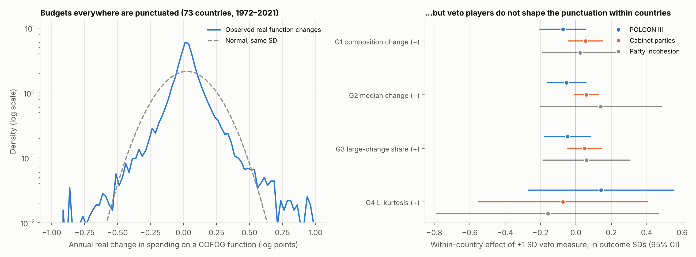
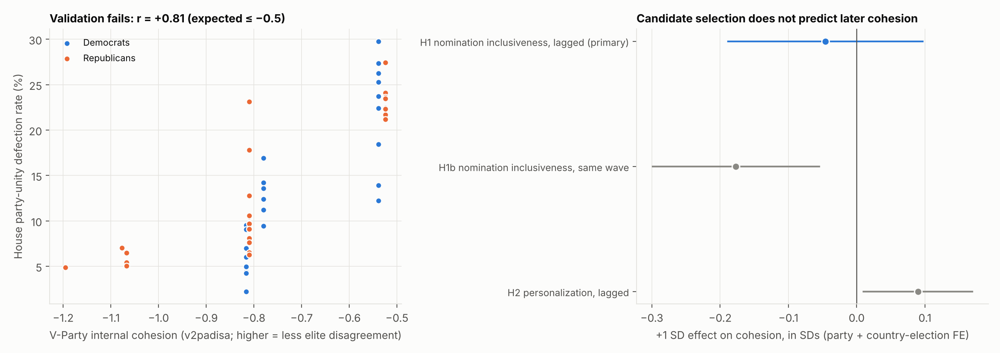

# Results V2: Budget punctuation and the party-organization first stage

This file reports **Part IV** of the project. Parts I–III, which cover the original cross-sectional
design, the electoral-reform, primary and cohesion designs, and the veto-player and
anti-defection designs, are in [`RESULTS.md`](RESULTS.md).

Part IV was pre-registered in [`docs/pre_analysis_plan_part4.md`](docs/pre_analysis_plan_part4.md)
(commit `d871ca7`) before any of its outcome regressions were run.

---

## Premise

### Where Part III left off

Part III ended with one robust but unidentified pattern: **looser parties go with steadier
budgets** (cross-section −0.43, Holm-adjusted p = 0.04). Three attempts to identify it within
countries failed:
1. Anti-defection laws did not move party cohesion (wrong-sign first stage).
2. Formal and informal veto players did not lower average annual fiscal change *within*
   countries, although they do *between* countries.
3. A 22-reform electoral catalogue failed its first stage, consistent with Colomer's
   reverse-causation argument.

A literature scan (see the research agenda in the conversation record) picked two cheap follow-ups
that target the two failures most directly.

### Question 1: Was the within-country veto-player null hiding a shift in the *shape* of budget change?

Punctuated-equilibrium theory (Jones & Baumgartner; Jones et al. 2009, AJPS; Breunig, Koski &
Mortensen 2010) holds that institutional friction does more than shrink changes. Friction
*suppresses moderate adjustments and stores pressure that is released in rare, large
punctuations*. So more veto players should mean:
- smaller typical changes;
- a greater share of very large changes;
- higher kurtosis (fatter tails) in the distribution of budget changes.

If those effects offset, the *mean* absolute change, which Part III tested, can stay flat. So a
null on the mean is not evidence against friction.

Jones et al. (2009) show the punctuated pattern holds across Western democracies. They attribute
cross-country differences to institutions, but only correlationally. Tsebelis & Chang (2004) test
veto players on *budget composition* change in 19 OECD countries, 1973–95. As far as we found,
neither has been tested **within countries** on a broad modern panel.

### Question 2: Is there a first stage for party cohesion in how parties select candidates?

Party-organization theory (Hazan & Rahat 2010, *Democracy within Parties*; Carey 2007, AJPS)
predicts that **more inclusive candidate selectorates** (members' or open primaries rather than
leader or executive selection) **weaken party cohesion**. Inclusive selection gives legislators a
constituency other than the leadership.

V-Party (V-Dem's party-level dataset: about 1,900 parties, 1970–2019) codes both candidate
nomination and internal cohesion at every election. That allows a party-level panel with party
fixed effects. A within-party link would supply the first stage that anti-defection laws could not.

---

## Design G: veto players and budget punctuation

**Data.**
- IMF Government Finance Statistics spending shares for 10 COFOG functions (via QoG), 1972–2021.
- General-government expenditure, % GDP: IMF *Public Finances in Modern History*, with Fiscal
  Monitor filling gaps.
- WDI real GDP growth.

**Outcomes** (all definitions fixed in the plan):
- **Real function growth:** g = Δlog share + Δlog(expenditure/GDP) + log(1 + growth).
- **Composition distance:** Euclidean distance between consecutive years' share vectors
  (Tsebelis & Chang).
- **Median |g|** across a country-year's functions.
- **Large-change share:** fraction of functions with |g| > 0.25.
- **L-kurtosis** (Hosking τ4) of function changes per country-decade.

**Veto measures.** Henisz POLCON III (primary); ParlGov cabinet parties; V-Dem party incohesion.

**Specification.** Two-way fixed effects (country and year; country and decade for L-kurtosis),
SEs clustered by country. Sample: V-Dem polyarchy > 0.5.

### Descriptive result: the "general empirical law" replicates globally

- **12,806 function-year spending changes** across **73 countries**.
- Pooled L-kurtosis is **0.397**, against 0.123 for a normal distribution.
- 9.5% of changes exceed 25% in real terms.

Budgets are strongly punctuated everywhere, extending Jones et al. (2009) from a handful of
Western democracies to a global panel.

### Within-country tests (pre-registered, POLCON)

| Test | Outcome | Prediction | Coef. | SE | p | Effect of +1 SD POLCON | Outcome mean | N (countries) |
|---|---|---|---|---|---|---|---|---|
| G1 | Composition distance (pp) | − | −3.11 | 2.80 | 0.27 | −0.32 pp | 2.82 | 848 (53) |
| G2 | Median \|g\| | − | −0.045 | 0.047 | 0.34 | −0.005 | 0.066 | 861 (53) |
| G3 | Large-change share | + | −0.072 | 0.101 | 0.48 | −0.008 | 0.067 | 861 (53) |
| G4 | L-kurtosis (country-decade) | + | +0.157 | 0.233 | 0.50 | +0.015 | 0.287 | 109 (39) |
| G5 (sec.) | P(\|Δ fiscal balance\| > 3 pp) | + | +0.117 | 0.174 | 0.50 | +0.013 | 0.132 | 861 (53) |

**Secondary veto measures** (all p ≥ 0.095):
- **Cabinet parties:** G1 +0.17, G2 +0.004 (p = 0.095, wrong sign), G3 +0.006, G4 −0.007.
- **Party incohesion:** G1 +0.13, G2 +0.016, G3 +0.012, G4 −0.021.

**Between countries (exploratory):** L-kurtosis on POLCON with decade fixed effects only gives
+0.13 (p = 0.16).

**Reading.**
- G1, G2 and G4 point the predicted way, but every estimate is small and imprecise.
- In outcome-SD units, the 95% intervals for POLCON exclude effects larger than about 0.2 SD on
  composition, median and large-change outcomes.
- **The Part III null on mean fiscal change was not masking a friction-driven shift toward
  punctuation.** Within countries, changes in veto points leave both the typical budget
  adjustment and its tails unchanged.
- The cross-country pattern Jones et al. attribute to institutions shows up here only weakly
  (p = 0.16), so it is probably a between-country association like POLCON's in Part III.

## Design H: candidate selection → party cohesion (V-Party)

**Data.** V-Party v2: party × election, 1970–2019.
- `v2panom`: nomination inclusiveness, 0 = leader decides … 4 = open primaries.
- `v2padisa`: internal cohesion, higher = less visible elite disagreement.
- `v2paind`: personalization.
- `v2pagovsup`: government participation.

### Step 1: measure validation (pre-registered rule) **fails**

| Check | N | r | Required | Result |
|---|---|---|---|---|
| US Democrats and Republicans: `v2padisa` vs House party-unity defection rate | 50 | **+0.81** | ≤ −0.5 | ❌ wrong sign |
| Seat-weighted `v2padisa` vs V-Dem legislative cohesion `v2pscohesv` (country-election) | 1,703 | +0.32 | ≥ 0.5 | ❌ |

This is the most informative result in Part IV. V-Party's "internal cohesion" asks whether party
*elites* display disagreement over strategy and whether some have *left*. It moves **opposite** to
floor-voting unity in the US:
- **1970s:** high defection rates, yet low visible elite conflict.
- **Today:** near-perfect party-line voting, alongside open factional warfare (Tea Party, Freedom
  Caucus).

So intra-party unity has at least two dimensions:
- **voting cohesion**: roll calls, V-Dem `v2pscohesv`;
- **organizational factionalism**: elites, exits, V-Party `v2padisa`.

They can move in opposite directions. This matches Part II's finding that caucus organization rose
as defections fell, and Clarke's (2020) account of factions as organized sub-brands. Comparative
work that uses `v2padisa` as a proxy for legislative unity would get the sign wrong in at least the
US case.

Following the convention set in Part II, the analyses below are therefore **exploratory**. They
concern *elite factionalism*, not legislative cohesion.

### Step 2: does candidate selection predict factionalism?

All models use party fixed effects + country × election-year fixed effects (identification comes
from parties changing relative to others in the same election), with SEs clustered by party.

| Test | Regressor | Coef. | SE | p | Effect of +1 SD (in cohesion SDs) | N (parties) |
|---|---|---|---|---|---|---|
| **H1 (primary)** | Nomination inclusiveness, **previous** election | −0.045 | 0.071 | **0.53** | −0.05 | 3,560 (655) |
| H1b | Nomination inclusiveness, **same** election | −0.168 | 0.059 | 0.005 | −0.18 | 4,988 (986) |
| H2 | Personalization, previous election | +0.084 | 0.038 | 0.028 | +0.09 | 3,560 (655) |
| H1 + H2 jointly | nomination / personalization (lagged) | −0.007 / +0.083 | 0.068 / 0.038 | 0.92 / 0.028 | — | 3,560 (655) |

**Reading.**
- **No first stage.** Lagged nomination rules do not predict later cohesion (F = 0.4).
- The same-wave association has the sign Hazan & Rahat predict: more inclusive selection goes with
  more visible disagreement. But it vanishes once the timing is enforced. That points to
  reverse causation (parties open their selection procedures after splits) or to the same experts
  rating both variables in one survey wave.
- **Personalization predicts later cohesion** (+0.09 SD, p = 0.028, secondary, not
  multiplicity-corrected). Leader-dominated parties show less elite dissent afterwards. This is
  plausible but exploratory.
- Under the plan, the instrumental-variable step (H3-IV) was **not run** because the first-stage
  F was below 10.

### Step 3: governing-party factionalism and fiscal change

Seat-weighted `v2padisa` of the parties governing after each election, carried forward to later
years. Country + year fixed effects, SEs clustered by country; polyarchy > 0.5, 1980–2019.

| Test | Outcome | Coef. | SE | p | N (countries) |
|---|---|---|---|---|---|
| **H3 (primary)** | \|Δ fiscal balance\| | −0.060 | 0.089 | **0.50** | 2,347 (111) |
| H3 secondary | \|Δ growth\| | +0.026 | 0.092 | 0.78 | 2,287 (110) |
| H3 secondary | 5-year SD fiscal | −0.109 | 0.070 | 0.12 | 2,135 (111) |

The prediction was +: more cohesive governments make larger fiscal changes. The estimate has the
other sign and is null.

## Primary hypothesis family (Holm, 6 tests)

| Test | Hypothesis | Predicted | Estimate | p | Holm |
|---|---|---|---|---|---|
| G1 | POLCON → budget composition distance | − | −3.11 | 0.27 | 1.00 |
| G2 | POLCON → median real function change | − | −0.045 | 0.34 | 1.00 |
| G3 | POLCON → share of large changes | + | −0.072 | 0.48 | 1.00 |
| G4 | POLCON → L-kurtosis | + | +0.157 | 0.50 | 1.00 |
| H1 | Lagged nomination inclusiveness → cohesion | − | −0.045 | 0.53 | 1.00 |
| H3 | Governing-party cohesion → \|Δ fiscal\| | + | −0.060 | 0.50 | 1.00 |

## Deviations from the plan

- **H validation failed.** The Part IV plan stated the validation rule but not its consequence.
  Following the convention set in Part II, H is labelled exploratory and interpreted as concerning
  elite factionalism.
- **The between-country L-kurtosis model is exploratory** and was not in the plan.
- **No other deviations.** Thresholds (0.5% minimum share, |g| ≤ 2 data-break rule, 25% large
  change, ≥ 30 observations per country-decade) were applied as registered.

## What Part IV adds

1. **Global replication of budget punctuation.** The leptokurtic "general empirical law of public
   budgets" holds across 73 countries (L-kurtosis 0.40).
2. **Veto players do not shape punctuation within countries.** This closes the possibility that
   Part III's within-country null was hiding a friction effect in the tails. Formal veto points,
   coalition size and party incohesion all leave the full distribution of budget changes
   unchanged when they vary within a country.
3. **Two dimensions of intra-party unity.** Expert-coded elite factionalism (V-Party) moves
   *opposite* to roll-call voting unity in the US (r = +0.81 with defection). Cohesion measures
   are not interchangeable, and the choice can reverse a sign.
4. **Candidate-selection rules are not a usable first stage** for cohesion. Same-wave associations
   disappear under temporal ordering.

**Bottom line across Parts I–IV.** The association between looser parties and steadier budgets
(Part II C1b) remains a **between-country** regularity among established democracies. None of
seven within-country strategies has identified it:
- electoral reforms;
- top-two primaries;
- anti-defection laws;
- cabinet and veto-point changes;
- an electoral-reform catalogue;
- budget punctuation;
- candidate-selection rules.

The strongest remaining routes are the ones that need new data collection (see the research
agenda):
- local seat-allocation regression discontinuities (Artés & Jurado-style) on budget volatility;
- a speech-based, validated dissent measure (ParlSpeech + LLM positioning);
- sharp single-state veto-point shocks such as California's Proposition 25 (2010).

## Files

- **Scripts:** `scripts/15_budget_punctuation.py`, `scripts/16_vparty.py`, `scripts/17_part4_summary.py`
- **G tables:** `output/tables/budget_punctuation.csv`, `budget_punctuation_between.csv`
- **H tables:** `output/tables/vparty_validation.csv`, `vparty_party_models.csv`, `vparty_fiscal_models.csv`
- **Holm family:** `output/tables/part4_primary_holm.csv`
- **Processed data:** `data/processed/budget_punctuation_country_year.csv`, `budget_punctuation_country_decade.csv`, `vparty_governing_panel.csv`
- **Figures:** `output/figures/part4_budget_punctuation.png`, `output/figures/part4_vparty.png`

## References

- Breunig, C., Koski, C. & Mortensen, P. B. (2010). Stability and punctuations in public spending. *JPART* 20(3).
- Carey, J. M. (2007). Competing principals, political institutions, and party unity in legislative voting. *AJPS* 51(1).
- Clarke, A. J. (2020). Party sub-brands and American party factions. *AJPS*.
- Colomer, J. M. (2005). It's parties that choose electoral systems (or, Duverger's laws upside down). *Political Studies* 53(1).
- Hazan, R. Y. & Rahat, G. (2010). *Democracy within Parties: Candidate Selection Methods and Their Political Consequences*. Oxford UP.
- Jones, B. D., Baumgartner, F. R., Breunig, C., Wlezien, C., et al. (2009). A general empirical law of public budgets. *AJPS* 53(4).
- Tsebelis, G. & Chang, E. C. C. (2004). Veto players and the structure of budgets in advanced industrialized countries. *EJPR* 43(3).
- V-Party: Lührmann, A., et al. (2020). Varieties of Party Identity and Organization (V-Party) dataset, V-Dem Institute.
